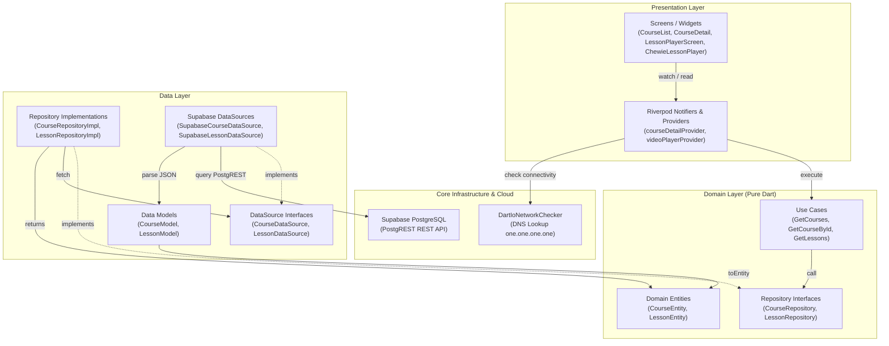
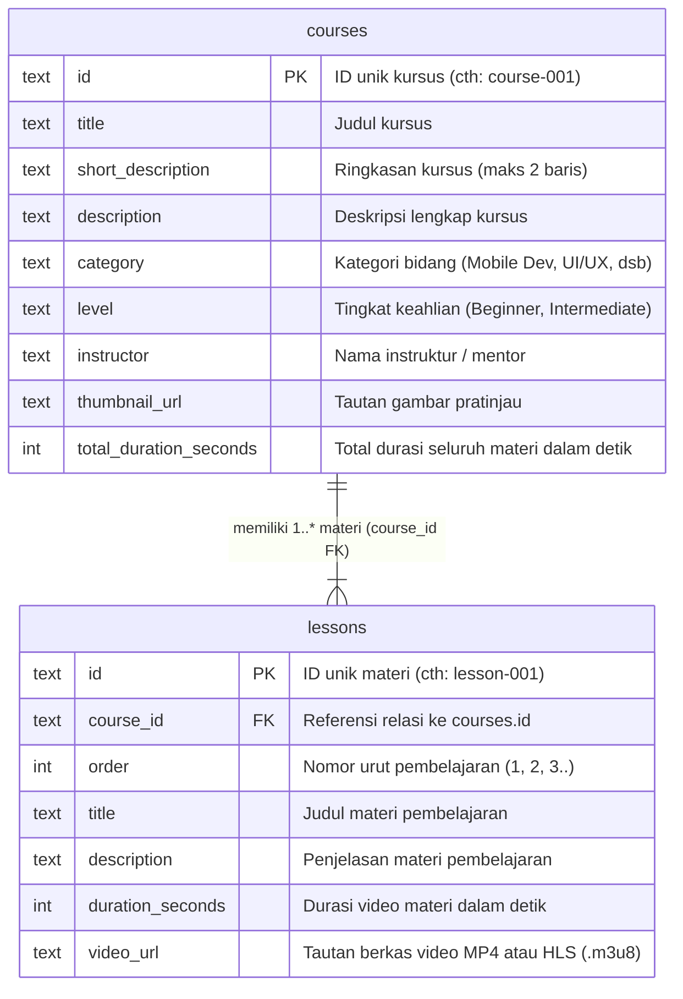
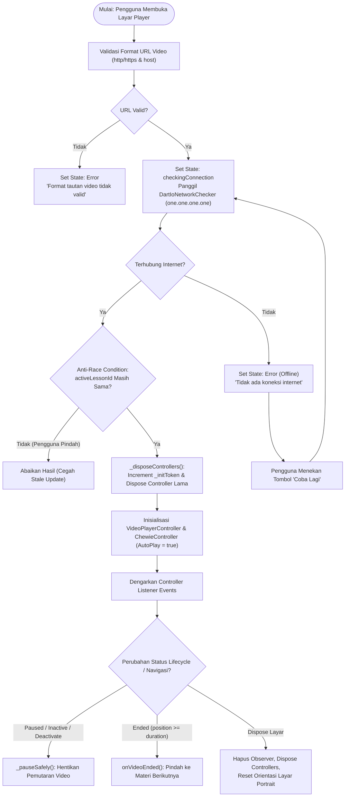

# Simple E-Learning Platform (Student Side)

Aplikasi mobile pembelajaran interaktif (*Simple E-Learning Platform*) untuk sisi siswa (*Student*) yang dibangun menggunakan **Flutter** dan **Dart 3** dengan menerapkan arsitektur **Feature-First Clean Architecture**, state management reaktif **Riverpod**, navigasi deklaratif **GoRouter**, backend cloud database **Supabase PostgreSQL**, serta manajemen siklus hidup (*strict lifecycle management*) pemutar video native **`video_player`** & **`chewie`**.

---

## Daftar Isi
1. [Ringkasan Proyek & Fitur Utama](#ringkasan-proyek--fitur-utama)
2. [Tech Stack & Justifikasi Pemilihan](#tech-stack--justifikasi-pemilihan)
3. [Arsitektur & System Design](#arsitektur--system-design)
4. [Skema Basis Data Supabase PostgreSQL & PostgREST API](#skema-basis-data-supabase-postgresql--postgrest-api)
5. [Flowchart Alur Pemutaran Video & Lifecycle Chewie](#flowchart-alur-pemutaran-video--lifecycle-chewie)
6. [Persyaratan, Konfigurasi Environment & Cara Menjalankan](#persyaratan-konfigurasi-environment--cara-menjalankan)
7. [Asumsi Teknis & Keterbatasan](#asumsi-teknis--keterbatasan)

---

## Ringkasan Proyek & Fitur Utama

Aplikasi ini berfokus pada pengalaman belajar siswa yang mulus, stabil, dan andal dalam mengakses katalog kursus serta memutar materi video:

- **Katalog Kursus (Course List):**
  - Menampilkan daftar kursus langsung dari Supabase PostgreSQL dengan thumbnail 16:9, label kategori, tingkat kesulitan (*level*), nama instruktur, jumlah materi, dan total durasi.
  - Tata letak responsif: 1 kolom (*ListView*) pada layar ponsel sempit dan 2 kolom (*GridView*) pada layar tablet/lebar (breakpoint $\ge 600$ px).
  - Dilengkapi fitur *Pull-to-Refresh* (`RefreshIndicator`) untuk memuat ulang data secara reaktif.
- **Detail Kursus & Silabus (Course Detail):**
  - Menampilkan informasi komprehensif kursus, deskripsi lengkap, serta daftar seluruh materi pembelajaran (*syllabus*) terurut.
  - Tombol aksi utama (*Call-to-Action*) **"Mulai Belajar"** yang langsung membuka materi pertama.
- **Pemutar Video Native Chewie & Navigasi Silabus (Lesson Player):**
  - Pemutar video native berbasis **`video_player`** dan **`chewie`** rasio 16:9 yang mendukung format MP4 dan HLS stream (`.m3u8`).
  - Strict lifecycle management: otomatis jeda saat aplikasi di-minimize/background, pencegahan race condition saat berpindah materi cepat dengan token incrementing.
  - Pergantian materi secara dinamis tanpa menumpuk (*stack*) route navigasi baru.
  - Tombol navigasi **"Sebelumnya"** dan **"Berikutnya"** yang aktif secara kontekstual sesuai urutan materi.
  - Otomatis memutar materi berikutnya saat video aktif telah selesai (*onVideoEnded*).
- **Penanganan State Eksplisit (Explicit State Handling):**
  - Seluruh alur data menangani kondisi `Loading`, `Empty Data`, `Offline/Network Failure`, `Parsing Error`, serta `Playback Failure` secara eksplisit dan ramah pengguna (*user-friendly*), lengkap dengan opsi pemulihan **"Coba Lagi"**.

---

## Tech Stack & Justifikasi Pemilihan

| Komponen | Pustaka / Teknologi | Justifikasi Teknis |
| :--- | :--- | :--- |
| **Framework & Bahasa** | **Flutter 3.50.0**<br>**Dart SDK 3.14.0** | *Cross-platform native performance*, didukung fitur Dart 3 modern (*sealed classes*, *class modifiers*, *exhaustive pattern matching*, dan *sound null-safety*). |
| **State Management & DI** | **flutter_riverpod (v3.5.0)** | Manajemen dependensi (*dependency injection*) *compile-time safe*, reaktif, modular, bebas dari *global state pollution*, serta mendukung `autoDispose` untuk membersihkan alokasi memori secara otomatis saat widget dihancurkan. |
| **Backend & Cloud Database** | **supabase_flutter (v2.18.3)** | Menggunakan Supabase PostgreSQL API via PostgREST client untuk query relasional cepat (`select('*, lessons(*)')`) tanpa overhead backend server kustom. |
| **Navigasi Deklaratif** | **go_router (v18.1.4)** | Navigasi berbasis URL/path yang sinkron dengan *deep linking*, penanganan rute bersarang (*nested route*), ekstraksi path parameter (`courseId`, `lessonId`), dan *errorBuilder* terpusat. |
| **Pemutar Video Native** | **video_player (v2.14.1)**<br>**chewie (v1.18.1)** | Pemutar video native berkinerja tinggi, kontrol interaktif Material Design 3 bawaan, dukungan fullscreen, audio muting, serta format MP4 dan HLS (`.m3u8`). |
| **Pola Repositori Bersih** | **Clean Data Sources** | Mengisolasi data source di balik kontrak *abstract interface class* (`CourseDataSource`, `LessonDataSource`), memudahkan peralihan antara Supabase dan MockDataSource untuk pengujian otomatis (*unit/widget testing*). |

---

## Arsitektur & System Design

Aplikasi menerapkan **Feature-First Clean Architecture** yang memisahkan kode berdasarkan fitur fungsional (`course`, `lesson`, `video_player`) dan lapisan tanggung jawab (*layer*):

```
lib/
├── core/                                # Komponen fondasi global lintas fitur
│   ├── constants/                       # Path aset & SupabaseConfig (supabase_config.dart)
│   ├── di/                              # Provider fondasi (core_providers.dart)
│   ├── errors/                          # Failure hierarchy (failures.dart)
│   ├── network/                         # Pemeriksa koneksi DNS IPv4 (network_checker.dart)
│   ├── router/                          # Konfigurasi GoRouter (app_routes.dart, app_router.dart)
│   ├── services/                        # Service JSON lokal (local_json_service.dart)
│   ├── theme/                           # Desain sistem & tema MD3 (app_colors.dart, app_theme.dart)
│   ├── utils/                           # Formatter durasi (duration_formatter.dart)
│   └── widgets/                         # Widget global (loading, empty, error, network_image)
├── features/
│   ├── course/                          # Fitur Katalog & Detail Kursus
│   │   ├── domain/                      # entities, repositories, usecases
│   │   ├── data/                        # models, data_sources (Supabase & Mock), repositories
│   │   └── presentation/                # providers, screens, widgets
│   ├── lesson/                          # Fitur Silabus & Materi Pembelajaran
│   │   ├── domain/                      # entities, repositories, usecases
│   │   ├── data/                        # models, data_sources (Supabase & Mock), repositories
│   │   └── presentation/                # providers, widgets
│   └── video_player/                    # Fitur Pemutar Video Chewie
│       └── presentation/                # providers (state & notifier), screens, widgets (ChewieLessonPlayer)
└── main.dart                            # Entry point aplikasi, inisialisasi Supabase & ProviderScope
```

### Diagram Aliran Data & Komponen



---

## Skema Basis Data Supabase PostgreSQL & PostgREST API

### Entity Relationship Diagram (ERD)



### PostgREST API Queries

1. **Daftar Seluruh Kursus Beserta Silabus:**
   ```dart
   final response = await client
       .from('courses')
       .select('*, lessons(*)')
       .order('id', ascending: true);
   ```
2. **Detail Satu Kursus Berdasarkan ID:**
   ```dart
   final response = await client
       .from('courses')
       .select('*, lessons(*)')
       .eq('id', courseId)
       .maybeSingle();
   ```
3. **Materi Kursus Berdasarkan `course_id`:**
   ```dart
   final response = await client
       .from('lessons')
       .select()
       .eq('course_id', courseId)
       .order('order', ascending: true);
   ```

---

## Flowchart Alur Pemutaran Video & Lifecycle Chewie

Diagram berikut menjelaskan siklus hidup pemutaran video native Chewie, perlindungan terhadap kebocoran memori (*memory leak*), pencegahan *race conditions* saat berganti materi cepat, dan integrasi Riverpod yang aman dari fase build:



---

## Persyaratan, Konfigurasi Environment & Cara Menjalankan

### Persyaratan Lingkungan
- **Flutter SDK:** Version `3.50.0` (channel stable) atau lebih tinggi
- **Dart SDK:** Version `3.14.0` atau lebih tinggi
- **Android Target SDK:** `34` (Android 14)
- **Android Min SDK:** `21` (Android 5.0 Lollipop)
- **Izin Android:** `android.permission.INTERNET` (terpasang di `AndroidManifest.xml`)

### Konfigurasi Compile-Time Environment (Supabase)
Kredensial Supabase dimasukkan secara aman saat kompilasi (*compile-time environment*) tanpa menuliskan kunci sensitif ke dalam kode repositori:

```bash
--dart-define=SUPABASE_URL=https://your-project.supabase.co \
--dart-define=SUPABASE_ANON_KEY=your-anon-key-here
```

### Langkah Menjalankan Aplikasi
1. Buka terminal pada root repositori `d:\porto\e_learning_platform`.
2. Unduh seluruh dependensi proyek:
   ```bash
   flutter pub get
   ```
3. Jalankan verifikasi analisis statis kode (*linter*):
   ```bash
   flutter analyze
   ```
   *Hasil diharapkan: `No issues found!`*
4. Jalankan pengujian otomatis (*automated widget tests*):
   ```bash
   flutter test
   ```
   *Hasil diharapkan: `All tests passed!`*
5. Jalankan aplikasi pada perangkat fisik atau Emulator dengan kredensial Supabase:
   ```bash
   flutter run \
     --dart-define=SUPABASE_URL=https://your-project.supabase.co \
     --dart-define=SUPABASE_ANON_KEY=your-anon-key-here
   ```

---

## Asumsi Teknis & Keterbatasan

### Asumsi Teknis
- **Sisi Siswa (*Student-Only*):** Aplikasi berfokus murni pada pengalaman konsumsi materi siswa; tidak mencakup autentikasi login pengguna, registrasi akun, maupun sistem manajemen konten (*CMS/Admin*).
- **Ketersediaan Jaringan:** Pemuatan thumbnail gambar dan streaming video memerlukan koneksi internet aktif. Ketika perangkat dalam mode pesawat (*airplane mode*), aplikasi menampilkan pesan offline yang informatif dengan ikon indikator dan tombol coba lagi.
- **In-App Streaming:** Video diputar langsung di dalam aplikasi melalui komponen native tanpa melempar pengguna ke pemutar aplikasi eksternal.

### Daftar Keterbatasan
- **Penyimpanan Progres Lokal (*Watch History*):** Belum mengimplementasikan persistensi lokal (seperti `shared_preferences` atau `hive`) untuk menyimpan detik terakhir video yang ditonton pengguna.
- **Pencarian & Penyaringan Kursus:** Katalog kursus belum menyertakan bilah pencarian (*search bar*) atau filter berdasarkan kategori/tingkat kesulitan.
- **Unduhan Offline (*Offline Caching*):** Video belum mendukung fitur unduh luring (*offline caching*).
