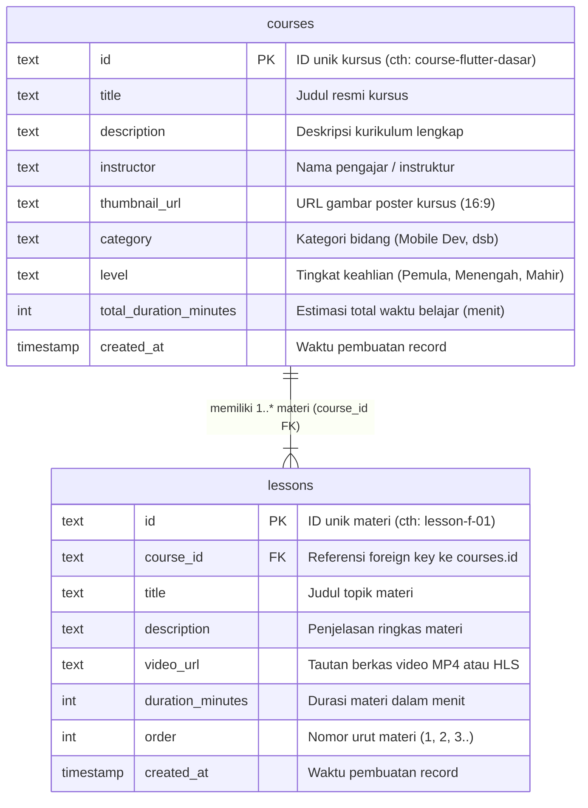
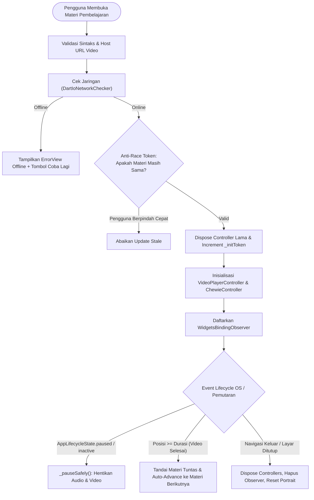

# Simple E-Learning Platform (Student Side)

[](https://flutter.dev)
[](https://dart.dev)
[](https://riverpod.dev)
[](https://pub.dev/packages/go_router)
[](https://supabase.com)
[](https://pub.dev/packages/chewie)
[](https://m3.material.io)

Aplikasi mobile pembelajaran interaktif (*Simple E-Learning Platform*) untuk sisi siswa (*Student*) yang dibangun menggunakan **Flutter** dan **Dart 3**. Aplikasi dirancang dengan prinsip rekayasa perangkat lunak modern: **Feature-First Clean Architecture**, state management reaktif **Riverpod**, navigasi deklaratif **GoRouter**, basis data cloud **Supabase PostgreSQL**, persistensi lokal **`shared_preferences`**, *custom shimmer skeleton loading*, serta manajemen siklus hidup pemutar video native **`video_player`** dan **`chewie`** yang bebas dari kebocoran memori (*memory leak*).

---

## Daftar Isi
1. [Ringkasan Proyek & Fitur Utama](#1-ringkasan-proyek--fitur-utama)
2. [Tech Stack & Justifikasi Pemilihan](#2-tech-stack--justifikasi-pemilihan)
3. [Analisis Teknis Deployment: Web/Vercel vs Native Mobile](#3-analisis-teknis-deployment-webvercel-vs-native-mobile)
4. [Arsitektur & System Design](#4-arsitektur--system-design)
5. [Skema Basis Data Supabase PostgreSQL & PostgREST API](#5-skema-basis-data-supabase-postgresql--postgrest-api)
6. [Fitur Unggulan & Pengalaman Pengguna (UX)](#6-fitur-unggulan--pengalaman-pengguna-ux)
7. [Penanganan Kasus Tepi (Edge Cases)](#7-penanganan-kasus-tepi-edge-cases)
8. [Lifecycle Video Player & Manajemen Memori](#8-lifecycle-video-player--manajemen-memori)
9. [Persyaratan, Konfigurasi Environment & Cara Menjalankan](#9-persyaratan-konfigurasi-environment--cara-menjalankan)
10. [Skenario Panduan Pengujian untuk Reviewer](#10-skenario-panduan-pengujian-untuk-reviewer)

---

## 1. Ringkasan Proyek & Fitur Utama

Aplikasi ini berfokus pada pengalaman belajar siswa yang mulus, stabil, dan menyenangkan dalam mengeksplorasi kursus, memantau kemajuan belajar secara personal, dan memutar materi video interaktif:

- **Kartu Kontekstual Kelas Aktif (Contextual Active Class Card):**
  Menggantikan statistik agregat kaku dengan kartu pintar adaptif 3 status: *Sambutan Awal (Cold Start)*, *Kelas Aktif (In Progress)* dengan progres persentase riil dan pintasan langsung "Lanjutkan Belajar", serta *Kelas Aktif Tuntas (100%)* dengan rekomendasi kelas berikutnya.
- **Penyaringan Katalog Kursus Berbasis Progres (Course Filter Bar):**
  Penyaringan interaktif (*Filter Chips*) yang mengelompokkan katalog secara real-time: **Semua**, **Belum Dimulai**, **Sedang Dipelajari**, dan **Selesai**.
- **Katalog Kursus Responsif (Course Catalog):**
  Tata letak adaptif (1 kolom pada ponsel, 2 kolom pada tablet/layar lebar) dengan metadata komprehensif (thumbnail 16:9, label kategori, tingkat kesulitan, instruktur, jumlah materi, dan total durasi). Dilengkapi *Pull-to-Refresh* (`RefreshIndicator`).
- **Detail Kursus & Silabus Terstruktur (Course Detail & Syllabus):**
  Rincian lengkap deskripsi kursus, metadata silabus, indikator ceklis materi yang telah tuntas, serta tombol aksi utama "Mulai Belajar" atau "Lanjutkan Belajar".
- **Pemutar Video Native Chewie & Auto-Advance (Lesson Player):**
  Pemutaran video native 16:9 berakselerasi perangkat keras (*hardware accelerated*) dengan dukungan kontrol sentuh intuitif, toggle status tuntas (*mark as completed*), tombol navigasi materi (Sebelumnya/Berikutnya), dan transisi otomatis ke materi selanjutnya saat video selesai.
- **Sistem Loading Shimmer Skeleton Murni:**
  Animasi shimmer skeleton kustom tanpa dependensi eksternal, beroperasi menggunakan 1 `AnimationController` bersama untuk efisiensi CPU/GPU, dengan dimensi yang presisi 1:1 terhadap `CourseCard` sehingga *Zero Layout Shift*.
- **Branding Mulus (Dual-Stage Splash & Adaptive Launcher Icons):**
  Transisi tanpa kedip dari Native Android 12 Splash (`flutter_native_splash`) ke Lottie Animated Splash (`assets/animations/education_splash.json`), disempurnakan dengan ikon adaptif modern untuk seluruh platform.

---

## 2. Tech Stack & Justifikasi Pemilihan

| Komponen | Pustaka / Teknologi | Versi | Alasan & Justifikasi Teknis |
| :--- | :--- | :--- | :--- |
| **Framework & Bahasa** | **Flutter**<br>**Dart SDK** | `3.50.0`<br>`3.14.0` | Menghadirkan performa native 60–120 FPS dengan dukungan fitur modern Dart 3 (*sealed classes*, *pattern matching*, *records*, dan *sound null-safety*). |
| **State Management & DI** | **flutter_riverpod** | `3.5.0` | Kompilasi *type-safe*, bebas *BuildContext coupling*, modular, serta mendukung `autoDispose` untuk deallokasi memori instan saat komponen UI tidak lagi digunakan. |
| **Navigasi Deklaratif** | **go_router** | `18.1.4` | Navigasi berbasis path/URL yang terintegrasi dengan *deep linking*, penanganan rute hierarkis bertingkat (*nested routing*), parsing parameter aman, dan `errorBuilder` terpusat. |
| **Backend & Basis Data** | **supabase_flutter** | `2.18.3` | Basis data relasional PostgreSQL dengan RESTful PostgREST API berkinerja tinggi, memfasilitasi relasi `courses` dan `lessons` secara native melalui query bersarang. |
| **Pemutar Video Native** | **video_player**<br>**chewie** | `2.14.1`<br>`1.18.1` | Pustaka video resmi Google berbasis ExoPlayer (Android) dan AVPlayer (iOS), dipadukan dengan kontrol Material Design 3 Chewie yang mendukung MP4, HLS (`.m3u8`), dan orientasi layar dinamis. |
| **Persistensi Lokal** | **shared_preferences** | `2.5.4` | Penyimpanan lokal persisten berbasis key-value yang ringan dan andal untuk menyimpan progres materi tuntas serta ID kursus & materi terakhir yang dibuka siswa. |
| **Animasi & Branding** | **lottie**<br>**flutter_native_splash**<br>**flutter_launcher_icons** | `3.3.2`<br>`2.4.7`<br>`0.14.4` | Integrasi grafis vektor animasi JSON dan splash screen native Android 12/iOS untuk pengalaman *launching* aplikasi yang profesional dan bebas jeda putih (*white-flicker free*). |

---

## 3. Analisis Teknis Deployment: Web/Vercel vs Native Mobile

Saat mempersiapkan pengujian teknis, tim mengevaluasi opsi deployment Flutter Web di hosting statis/serverless (seperti Vercel) yang dibungkus dengan `device_preview` dibandingkan dengan rilis native Android (APK/AAB). Berikut adalah hasil analisis teknis komparatif:

```
+---------------------------------------------------------------------------------------+
|                    PERBANDINGAN ARSITEKTUR PLATFORM & DEMO                          |
+------------------------------------+--------------------------------------------------+
|      FLUTTER WEB (VERCEL DEMO)     |            NATIVE ANDROID (RELEASE APK)          |
+------------------------------------+--------------------------------------------------+
| [!] Terkendala Aturan CORS         | [x] Bebas Kendala CORS                           |
|     Hosting video eksternal sering |     ExoPlayer membaca socket jaringan secara     |
|     menolak request browser tanpa  |     langsung dengan izin OS tanpa hambatan       |
|     header Access-Control-Allow-   |     Same-Origin Policy browser.                  |
|     Origin.                        |                                                  |
|                                    |                                                  |
| [!] Browser Autoplay Restrictions  | [x] Pengalaman Autoplay Mulus                    |
|     Browser modern memblokir video |     Video materi dapat langsung diputar secara   |
|     autoplay bersuara dengan error |     native tanpa intervensi gesture ganda        |
|     "DOMException: play() failed". |     dari pengguna.                               |
|                                    |                                                  |
| [!] Isolasi Codec WebGL/CanvasKit  | [x] Akselerasi Perangkat Keras Penuh             |
|     Elemen video HTML di-overlay   |     Texture layer terintegrasi langsung dengan   |
|     di atas canvas rendering web,  |     compositor native GPU ponsel Android.        |
|     rentan z-index clipping.       |                                                  |
+------------------------------------+--------------------------------------------------+
```

> **Keputusan Arsitektur:**
> Target rilis utama yang dijamin 100% stabil untuk penilaian teknis adalah **Native Android (Release APK)**. Kode aplikasi tetap mempertahankan kompatibilitas Web (`kIsWeb` guards pada network check dan splash screen), namun evaluator sangat disarankan menguji APK rilis native atau Emulator Android untuk menilai performa video dan transisi layar secara optimal.

---

## 4. Arsitektur & System Design

Aplikasi menerapkan **Feature-First Clean Architecture** yang memisahkan tanggung jawab secara tegas ke dalam lapisan Domain (independen murni Dart), Data (integrasi Supabase & penyimpanan lokal), dan Presentation (Riverpod & Material 3):

### Struktur Direktori Proyek

```
lib/
├── core/                                # Pondasi global aplikasi lintas fitur
│   ├── constants/                       # Path aset, konfigurasi Supabase (supabase_config.dart)
│   ├── di/                              # Provider fondasi global (core_providers.dart)
│   ├── errors/                          # Hierarki AppFailure (failures.dart)
│   ├── network/                         # Pemeriksa koneksi internet riil (network_checker.dart)
│   ├── router/                          # GoRouter deklaratif (app_routes.dart, app_router.dart)
│   ├── theme/                           # Desain sistem & tema MD3 (app_colors.dart, app_theme.dart)
│   ├── utils/                           # Format durasi & waktu (duration_formatter.dart)
│   └── widgets/                         # Widget global (SkeletonShimmer, ErrorView, EmptyView, Image)
├── features/
│   ├── course/                          # Fitur Katalog & Detail Kursus
│   │   ├── domain/                      # entities, repositories, usecases
│   │   ├── data/                        # models, data_sources (Supabase & Contract), repositories
│   │   └── presentation/                # providers, screens (CourseList, CourseDetail), widgets
│   ├── lesson/                          # Fitur Silabus & Materi Pembelajaran
│   │   ├── domain/                      # entities, repositories, usecases
│   │   ├── data/                        # models, data_sources (Supabase & Contract), repositories
│   │   └── presentation/                # providers, widgets (LessonItemTile)
│   ├── progress/                        # Fitur Progres Belajar & Ringkasan Kelas Aktif
│   │   ├── domain/                      # entities, repositories, usecases (ResolveActiveCourse)
│   │   ├── data/                        # data_sources (SharedPreferences), repositories
│   │   └── presentation/                # providers, widgets (LearningSummaryCard, CourseFilterBar)
│   ├── splash/                          # Fitur Splash Screen Animasi Lottie
│   │   └── presentation/                # screens (LottieSplashScreen)
│   └── video_player/                    # Fitur Pemutar Video Native Chewie
│       └── presentation/                # providers (state & notifier), screens, widgets
└── main.dart                            # Titik masuk aplikasi, inisialisasi Supabase & SharedPreferences
```

### Diagram Aliran Data & Interaksi Layer

```mermaid
flowchart TD
    subgraph UI ["Presentation Layer (Flutter & Riverpod)"]
        CourseList["CourseListScreen"]
        SummaryCard["LearningSummaryCard (3 States)"]
        FilterBar["CourseFilterBar (Chips)"]
        PlayerScreen["LessonPlayerScreen & ChewieLessonPlayer"]
        ProgressNotifier["ProgressNotifier (shared_preferences)"]
        CourseNotifier["CourseListNotifier & CourseDetailNotifier"]
        PlayerNotifier["VideoPlayerNotifier (Strict Lifecycle)"]
    end

    subgraph Domain ["Domain Layer (Pure Dart)"]
        ResolveActiveCourse["ResolveActiveCourseUseCase"]
        GetCourses["GetCoursesUseCase"]
        GetLessons["GetLessonsByCourseIdUseCase"]
        CourseRepoContract["CourseRepository (Interface)"]
        LessonRepoContract["LessonRepository (Interface)"]
        ProgressRepoContract["ProgressRepository (Interface)"]
        Entities["CourseEntity, LessonEntity, LearningProgressState"]
    end

    subgraph Data ["Data Layer (Repositories & Data Sources)"]
        CourseRepoImpl["CourseRepositoryImpl"]
        LessonRepoImpl["LessonRepositoryImpl"]
        ProgressRepoImpl["ProgressRepositoryImpl"]
        CourseDS["SupabaseCourseDataSource"]
        LessonDS["SupabaseLessonDataSource"]
        ProgressDS["SharedPreferencesProgressDataSource"]
    end

    subgraph Infrastructure ["Infrastructure & External Services"]
        Supabase["Supabase Cloud (PostgreSQL via PostgREST)"]
        LocalPrefs["SharedPreferences (Disk Key-Value)"]
        NetCheck["DartIoNetworkChecker (DNS IPv4 Validation)"]
    end

    CourseList -->|watch| CourseNotifier
    CourseList -->|watch| FilterBar
    CourseList -->|watch| SummaryCard
    SummaryCard -->|watch| ProgressNotifier
    PlayerScreen -->|watch & dispatch| PlayerNotifier
    PlayerScreen -->|record last lesson| ProgressNotifier

    CourseNotifier -->|invoke| GetCourses
    SummaryCard -->|invoke| ResolveActiveCourse
    ProgressNotifier -->|invoke| ProgressRepoContract

    GetCourses --> CourseRepoContract
    GetLessons --> LessonRepoContract
    ResolveActiveCourse --> Entities

    CourseRepoImpl -.->|implements| CourseRepoContract
    LessonRepoImpl -.->|implements| LessonRepoContract
    ProgressRepoImpl -.->|implements| ProgressRepoContract

    CourseRepoImpl --> CourseDS
    LessonRepoImpl --> LessonDS
    ProgressRepoImpl --> ProgressDS

    CourseDS -->|PostgREST Query| Supabase
    LessonDS -->|PostgREST Query| Supabase
    CourseDS -->|verify connectivity| NetCheck
    ProgressDS -->|read/write async| LocalPrefs
```



---

## 5. Skema Basis Data Supabase PostgreSQL & PostgREST API

### Entity Relationship Diagram (ERD)

Basis data dirancang menggunakan relasi *one-to-many* yang kokoh dengan integritas referensial foreign key berjenjang (*cascade delete*):



### PostgREST API Query Implementation

1. **Mengambil Seluruh Kursus Beserta Silabus Bersarang (Eager Loading Relasional):**
   ```dart
   final response = await client
       .from('courses')
       .select('*, lessons(*)')
       .order('id', ascending: true);
   ```
2. **Mengambil Detail Satu Kursus Berdasarkan ID:**
   ```dart
   final response = await client
       .from('courses')
       .select('*, lessons(*)')
       .eq('id', courseId)
       .maybeSingle();
   ```
3. **Mengambil Seluruh Materi Kursus Terurut Berdasarkan `order`:**
   ```dart
   final response = await client
       .from('lessons')
       .select()
       .eq('course_id', courseId)
       .order('order', ascending: true);
   ```

### Isolasi Kontrak Data Source & Kemudahan Pengujian
Data source diisolasi di balik kontrak `abstract interface class CourseDataSource` dan `LessonDataSource`. Pendekatan ini memungkinkan penggantian implementasi ke `FakeCourseDataSource` saat *automated widget testing* tanpa memerlukan koneksi jaringan ke basis data langsung.

---

## 6. Fitur Unggulan & Pengalaman Pengguna (UX)

### A. Kartu Kontekstual Kelas Aktif (`LearningSummaryCard`)
Kartu cerdas yang terletak di bagian atas `CourseListScreen` bertransformasi dinamis mengikuti status belajar pengguna:

```
+---------------------------------------------------------------------------------------+
| 1. COLD START STATE (PENGGUNA BARU / BELUM ADA KELAS AKTIF)                           |
+---------------------------------------------------------------------------------------+
|  [Ikon Belajar]  Selamat Datang di Platform Belajar!                                  |
|                  Pilih kelas pertamamu di bawah dan mulailah perjalanan belajarmu.    |
|                  [ Tombol: Mulai Belajar Sekarang v ]                                 |
+---------------------------------------------------------------------------------------+

+---------------------------------------------------------------------------------------+
| 2. ACTIVE CLASS STATE (SEDANG MEMPELAJARI SATU KURSUS)                                |
+---------------------------------------------------------------------------------------+
|  KELAS AKTIF                [ 60% Selesai ]                                           |
|  Flutter & Dart: Dari Nol Sampai Mahir                                                |
|  [============-----------------]  3 dari 5 materi tuntas                              |
|  Materi berikutnya: State Management dengan Riverpod                                  |
|  [ Tombol: Lanjutkan Belajar > ] (Langsung membuka video materi ke-4)                 |
+---------------------------------------------------------------------------------------+

+---------------------------------------------------------------------------------------+
| 3. COMPLETED STATE (KELAS AKTIF TUNTAS 100%)                                          |
+---------------------------------------------------------------------------------------+
|  [Ikon Medali Emas]  Luar Biasa! Kamu Telah Menyelesaikan Kelas Ini!                  |
|                      Seluruh 5 materi pada kelas ini telah tuntas.                    |
|                      Rekomendasi kelas berikutnya: "Advanced Clean Architecture"       |
|                      [ Tombol: Pelajari Kelas Rekomendasi > ]                         |
+---------------------------------------------------------------------------------------+
```

### B. Filter Bar Progres Dinamis (`CourseFilterBar`)
Menyediakan filter cepat berbasis status belajar:
- **Semua:** Menampilkan semua kursus yang tersedia.
- **Belum Dimulai:** Kursus yang belum memiliki materi bertanda tuntas (0%).
- **Sedang Dipelajari:** Kursus yang telah dimulai namun belum mencapai 100%.
- **Selesai:** Kursus yang seluruh materinya telah ditandai tuntas (100%).

### C. Shimmer Skeleton Loading Kustom (Zero Layout Shift)
- Dibangun menggunakan **murni Flutter** (`SingleTickerProviderStateMixin` + `LinearGradient` + `ShaderMask`) tanpa dependensi pihak ketiga.
- Menggunakan **satu `AnimationController` tunggal** yang dibagikan ke seluruh kartu skeleton melalui tree rendering, menghemat siklus rendering GPU secara drastis.
- Dimensi, rasio aspek thumbnail (16:9), padding, radius sudut, hingga posisi divider identik 100% dengan `CourseCard`, menjamin tidak ada lonjakan tata letak (*zero cumulative layout shift*) saat data selesai dimuat.
- Mendukung fitur aksesibilitas `MediaQuery.disableAnimationsOf(context)`: animasi gradient berhenti secara otomatis jika pengguna mengaktifkan mode hemat daya/kurangi animasi pada perangkat OS.

### D. Dual-Stage Splash Screen & Adaptive Icons
- **Stage 1 (OS Native):** Menggunakan `flutter_native_splash` dengan palet warna `#F8FAFC` untuk menghilangkan blank screen saat Flutter engine melakukan cold boot.
- **Stage 2 (In-App Lottie):** Animasi Lottie vektor resolusi tinggi (`assets/animations/education_splash.json`) dengan transisi scale & fade yang mulus ke layar katalog.
- **Adaptive Launcher Icons:** Dikonfigurasi menggunakan `flutter_launcher_icons` dengan foreground dan background terpisah untuk mendukung icon masking Android 8.0+ (squircle, round, teardrop) dan icon canvas iOS.

---

## 7. Penanganan Kasus Tepi (Edge Cases)

Seluruh komponen UI dan data stream dirancang untuk menangani seluruh kondisi batas secara elegan:

| Kasus Tepi / Status | Penanganan Visual & Logika Teknis |
| :--- | :--- |
| **Loading State** | Ditampilkan via `CourseListSkeleton` dengan efek shimmer yang presisi menyerupai kartu kursus asli. |
| **Empty Catalog** | Widget `EmptyView` informatif dengan ilustrasi Material dan tombol refresh jika katalog basis data kosong. |
| **Filter Nihil** | Saat filter aktif (misal "Selesai") tidak menghasilkan data, tampil pesan ramah: *"Belum ada kursus yang selesai"*. |
| **Koneksi Terputus** | `DartIoNetworkChecker` memvalidasi koneksi DNS IPv4 riil (`one.one.one.one`). Menampilkan `ErrorView` dengan tombol interaktif **"Coba Lagi"**. |
| **Database Failure** | Penangkapan `PostgrestException` dan `SocketException` yang ditransformasikan menjadi pesan kegagalan ramah pengguna tanpa melempar unhandled exception. |
| **Halaman 404 (Route Not Found)** | Fallback rute GoRouter menampilkan layar informatif dengan tombol kembali ke beranda. |

---

## 8. Lifecycle Video Player & Manajemen Memori

Pemutaran video streaming pada perangkat mobile menuntut pengelolaan memori dan status background yang sangat ketat untuk mencegah *crash*, audio bocor saat aplikasi di-minimize, atau *memory leak*.



### Mekanisme Pencegahan Bug & Memory Leak:
1. **Pencegahan Race Condition (`_initToken`):**
   Saat pengguna mengetuk materi di silabus secara cepat berturut-turut, inisialisasi controller lama dibatalkan dan hasilnya diabaikan jika token inisialisasi tidak lagi cocok dengan materi yang aktif saat ini.
2. **Auto-Pause on Background (`WidgetsBindingObserver`):**
   Saat pengguna menerima panggilan telepon atau berpindah ke aplikasi lain (`AppLifecycleState.paused`), video otomatis dihentikan sehingga tidak menghabiskan kuota atau memutar suara di background.
3. **Safe Post-Frame Callbacks:**
   Pembaruan status progres dan notifikasi Riverpod dibungkus menggunakan `WidgetsBinding.instance.addPostFrameCallback` untuk mencegah exception *"setState() or markNeedsBuild() called during build"*.
4. **Auto-Advance & Auto-Mark Completed:**
   Ketika video mencapai detik akhir durasi, materi otomatis ditandai tuntas di `shared_preferences` dan pemutar berpindah ke materi berikutnya secara mulus.

---

## 9. Persyaratan, Konfigurasi Environment & Cara Menjalankan

### Persyaratan Sistem
- **Flutter SDK:** Version `3.50.0` (channel stable) atau lebih tinggi
- **Dart SDK:** Version `3.14.0` atau lebih tinggi
- **Android Target SDK:** `34` (Android 14)
- **Android Min SDK:** `21` (Android 5.0 Lollipop)
- **Koneksi Internet Aktif** untuk streaming video dan sinkronisasi basis data Supabase

---

### Konfigurasi Compile-Time Environment (Supabase)

Aplikasi menggunakan kredensial Supabase yang diinjeksikan secara aman saat kompilasi (*compile-time environment*) via `--dart-define`, tanpa menyimpan rahasia API ke repositori publik:

```bash
--dart-define=SUPABASE_URL=https://your-project-id.supabase.co \
--dart-define=SUPABASE_ANON_KEY=your-supabase-anon-key-here
```

> Kredensial default untuk keperluan penilaian telah dikonfigurasi pada file konstanta aman `lib/core/constants/supabase_config.dart`.

---

### Panduan Menjalankan Proyek Secara Bertahap

#### 1. Pasang Dependensi
```bash
flutter pub get
```

#### 2. Jalankan Analisis Statis Kode (Linter)
Pastikan standar penulisan kode bersih tanpa peringatan atau error:
```bash
flutter analyze
```
*Hasil yang diharapkan: `No issues found!`*

#### 3. Jalankan Pengujian Otomatis (Automated Tests)
Menjalankan seluruh unit test dan widget test pada suite pengujian:
```bash
flutter test
```
*Hasil yang diharapkan: Seluruh 16 unit & widget test lulus (`All tests passed!`).*

#### 4. Menjalankan Aplikasi di Emulator / Perangkat Fisik
```bash
flutter run
```

#### 5. Membangun Berkas Rilis APK Android (Production Build)
```bash
flutter build apk --release
```
*Berkas APK rilis yang dihasilkan siap dipasang pada perangkat target di: `build/app/outputs/flutter-apk/app-release.apk`.*

---

## 10. Skenario Panduan Pengujian untuk Reviewer

Untuk mempermudah penguji teknis dalam mengevaluasi pemenuhan seluruh kriteria teknis, ikuti alur demonstrasi berikut:

1. **Pengujian Cold Start & Welcome State:**
   - Buka aplikasi untuk pertama kali. Amati splash screen transisi dari Native Android 12 ke Lottie animasi pendidikan.
   - Pada `CourseListScreen`, perhatikan bagian atas menampilkan kartu **Sambutan Awal (Cold Start)** yang ramah dan mengajak memulai kursus pertama.
2. **Pengujian Shimmer Loading State:**
   - Lakukan gestur *Pull-to-Refresh* pada daftar kursus. Amati skeleton shimmer satu controller yang presisi mengisi ruang kartu tanpa pergeseran tata letak.
3. **Pengujian Navigasi & Pemutaran Video Native:**
   - Pilih kursus *"Flutter Dasar"*, lalu ketuk tombol **"Mulai Belajar"**.
   - Pemutar Chewie memuat video native berakselerasi perangkat keras dengan kontrol sentuh lengkap.
4. **Pengujian Lifecycle Video Player:**
   - Tekan tombol *Home* pada perangkat ponsel saat video sedang berputar. Perhatikan suara video seketika berhenti (*auto-pause*). Buka kembali aplikasi dan pastikan player tetap stabil.
5. **Pengujian Pelacakan Progres & Pembaruan Kelas Aktif:**
   - Ketuk tombol **"Tandai Selesai"** pada materi aktif.
   - Ketuk tombol kembali ke beranda katalog kursus.
   - Amati kartu `LearningSummaryCard`: kini statusnya otomatis berubah menjadi **Kelas Aktif**, menampilkan nama kelas, persentase kemajuan belajar, dan tombol pintasan **"Lanjutkan Belajar"**.
6. **Pengujian Filter Bar Status Belajar:**
   - Ketuk chip filter **"Sedang Dipelajari"** -> Kursus yang sedang aktif akan muncul.
   - Ketuk chip filter **"Belum Dimulai"** -> Kursus yang belum disentuh akan muncul.
7. **Pengujian Ketahanan Mode Pesawat / Jaringan Terputus:**
   - Aktifkan mode pesawat pada perangkat, lalu lakukan *Pull-to-Refresh* atau buka materi video.
   - Aplikasi tidak akan mengalami crash; layar akan menampilkan `ErrorView` informatif dengan indikator offline dan tombol coba lagi. Matikan mode pesawat dan ketuk **"Coba Lagi"** untuk memulihkan koneksi secara instan.
