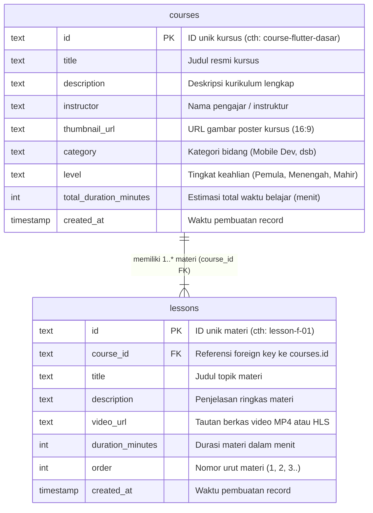
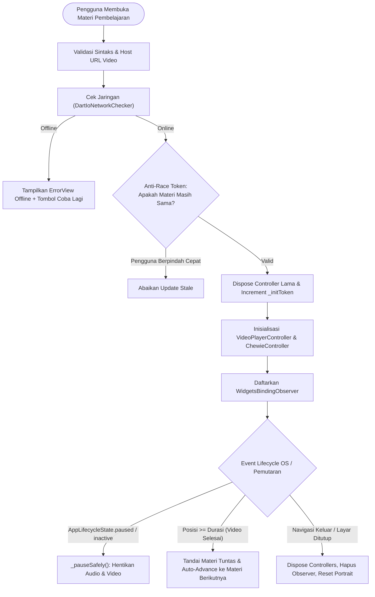

# System Design & Architecture Document

Dokumen ini berisi detail teknis komprehensif mengenai arsitektur sistem, struktur proyek, model data, query API, siklus hidup pemutar video, serta pertimbangan teknis untuk Simple E-Learning Platform.

---

## 1. Tech Stack & Justifikasi Pemilihan

| Komponen | Pustaka / Teknologi | Versi | Alasan & Justifikasi Teknis |
| :--- | :--- | :--- | :--- |
| **Framework & Bahasa** | **Flutter**<br>**Dart SDK** | `3.50.0`<br>`3.14.0` | Menghadirkan performa native 60–120 FPS dengan dukungan fitur modern Dart 3 (*sealed classes*, *pattern matching*, *records*, dan *sound null-safety*). |
| **State Management & DI** | **flutter_riverpod** | `3.5.0` | Kompilasi *type-safe*, bebas *BuildContext coupling*, modular, serta mendukung manajemen alokasi memori reaktif instan saat komponen UI tidak lagi digunakan. |
| **Navigasi Deklaratif** | **go_router** | `18.1.4` | Navigasi berbasis path/URL yang terintegrasi dengan *deep linking*, penanganan rute hierarkis bertingkat (*nested routing*), parsing parameter aman, dan `errorBuilder` terpusat. |
| **Backend & Basis Data** | **supabase_flutter** | `2.18.3` | Basis data relasional PostgreSQL dengan RESTful PostgREST API berkinerja tinggi, memfasilitasi relasi `courses` dan `lessons` secara native melalui query bersarang. |
| **Pemutar Video Native** | **video_player**<br>**chewie** | `2.14.1`<br>`1.18.1` | Pustaka video resmi Google berbasis ExoPlayer (Android) dan AVPlayer (iOS), dipadukan dengan kontrol Material Design 3 Chewie yang mendukung MP4, HLS (`.m3u8`), dan orientasi layar dinamis. |
| **Persistensi Lokal** | **shared_preferences** | `2.5.4` | Penyimpanan lokal persisten berbasis key-value yang ringan dan andal untuk menyimpan progres materi tuntas serta ID kursus & materi terakhir yang dibuka siswa. |
| **Animasi & Branding** | **lottie**<br>**flutter_native_splash**<br>**flutter_launcher_icons** | `3.3.2`<br>`2.4.7`<br>`0.14.4` | Integrasi grafis vektor animasi JSON dan splash screen native Android 12/iOS untuk pengalaman *launching* aplikasi yang profesional dan bebas jeda putih (*white-flicker free*). |

---

## 2. Analisis Teknis Deployment: Web/Vercel vs Native Mobile

Saat mengevaluasi opsi deployment Flutter Web (seperti Vercel) dibandingkan dengan rilis native Android (APK/AAB):

```
+---------------------------------------------------------------------------------------+
|                    PERBANDINGAN ARSITEKTUR PLATFORM & DEMO                          |
+------------------------------------+--------------------------------------------------+
|      FLUTTER WEB (VERCEL DEMO)     |            NATIVE ANDROID (RELEASE APK)          |
+------------------------------------+--------------------------------------------------+
| [!] Terkendala Aturan CORS         | [x] Bebas Kendala CORS                           |
|     Hosting video eksternal sering |     ExoPlayer membaca socket jaringan secara     |
|     menolak request browser tanpa  |     langsung dengan izin OS tanpa hambatan       |
|     header Access-Control-Allow-   |     Same-Origin Policy browser.                  |
|     Origin.                        |                                                  |
|                                    |                                                  |
| [!] Browser Autoplay Restrictions  | [x] Pengalaman Autoplay Mulus                    |
|     Browser modern memblokir video |     Video materi dapat langsung diputar secara   |
|     autoplay bersuara dengan error |     native tanpa intervensi gesture ganda        |
|     "DOMException: play() failed". |     dari pengguna.                               |
|                                    |                                                  |
| [!] Isolasi Codec WebGL/CanvasKit  | [x] Akselerasi Perangkat Keras Penuh             |
|     Elemen video HTML di-overlay   |     Texture layer terintegrasi langsung dengan   |
|     di atas canvas rendering web,  |     compositor native GPU ponsel Android.        |
|     rentan z-index clipping.       |                                                  |
+------------------------------------+--------------------------------------------------+
```

> **Keputusan:**
> Target rilis utama yang dijamin 100% stabil untuk penilaian teknis adalah **Native Android (Release APK)**. Kode aplikasi tetap mempertahankan kompatibilitas Web (`kIsWeb` guards pada network check dan splash screen), namun evaluator disarankan menguji APK rilis native atau Emulator Android untuk menilai performa video dan transisi layar secara optimal.

---

## 3. Arsitektur & System Design

Aplikasi menerapkan **Feature-First Clean Architecture** yang memisahkan tanggung jawab secara tegas ke dalam lapisan Domain (independen murni Dart), Data (integrasi Supabase & penyimpanan lokal), dan Presentation (Riverpod & Material 3):

### Struktur Direktori Proyek

```
lib/
├── core/                                # Pondasi global aplikasi lintas fitur
│   ├── constants/                       # Path aset, konfigurasi Supabase (supabase_config.dart)
│   ├── di/                              # Provider fondasi global (core_providers.dart)
│   ├── errors/                          # Hierarki AppFailure (failures.dart)
│   ├── network/                         # Pemeriksa koneksi internet riil (network_checker.dart)
│   ├── router/                          # GoRouter deklaratif (app_routes.dart, app_router.dart)
│   ├── theme/                           # Desain sistem & tema MD3 (app_colors.dart, app_theme.dart)
│   ├── utils/                           # Format durasi & waktu (duration_formatter.dart)
│   └── widgets/                         # Widget global (SkeletonShimmer, ErrorView, EmptyView, Image)
├── features/
│   ├── course/                          # Fitur Katalog & Detail Kursus
│   │   ├── domain/                      # entities, repositories, usecases
│   │   ├── data/                        # models, data_sources (Supabase & Contract), repositories
│   │   └── presentation/                # providers, screens (CourseList, CourseDetail), widgets
│   ├── lesson/                          # Fitur Silabus & Materi Pembelajaran
│   │   ├── domain/                      # entities, repositories, usecases
│   │   ├── data/                        # models, data_sources (Supabase & Contract), repositories
│   │   └── presentation/                # providers, widgets (LessonItemTile)
│   ├── progress/                        # Fitur Progres Belajar & Ringkasan Kelas Aktif
│   │   ├── domain/                      # entities, repositories, usecases (ResolveActiveCourse)
│   │   ├── data/                        # data_sources (SharedPreferences), repositories
│   │   └── presentation/                # providers, widgets (LearningSummaryCard, CourseFilterBar)
│   ├── splash/                          # Fitur Splash Screen Animasi Lottie & Preloader
│   │   └── presentation/                # screens (SplashScreen)
│   └── video_player/                    # Fitur Pemutar Video Native Chewie
│       └── presentation/                # providers (state & notifier), screens, widgets
└── main.dart                            # Titik masuk aplikasi, inisialisasi Supabase & SharedPreferences
```

### Diagram Aliran Data & Interaksi Layer

```mermaid
flowchart TD
    subgraph UI ["Presentation Layer (Flutter & Riverpod)"]
        CourseList["CourseListScreen"]
        SummaryCard["LearningSummaryCard (3 States)"]
        FilterBar["CourseFilterBar (Chips)"]
        PlayerScreen["LessonPlayerScreen & ChewieLessonPlayer"]
        ProgressNotifier["ProgressNotifier (shared_preferences)"]
        CourseNotifier["CourseListNotifier & CourseDetailNotifier"]
        PlayerNotifier["VideoPlayerNotifier (Strict Lifecycle)"]
    end

    subgraph Domain ["Domain Layer (Pure Dart)"]
        ResolveActiveCourse["ResolveActiveCourseUseCase"]
        GetCourses["GetCoursesUseCase"]
        GetLessons["GetLessonsByCourseIdUseCase"]
        CourseRepoContract["CourseRepository (Interface)"]
        LessonRepoContract["LessonRepository (Interface)"]
        ProgressRepoContract["ProgressRepository (Interface)"]
        Entities["CourseEntity, LessonEntity, LearningProgressState"]
    end

    subgraph Data ["Data Layer (Repositories & Data Sources)"]
        CourseRepoImpl["CourseRepositoryImpl"]
        LessonRepoImpl["LessonRepositoryImpl"]
        ProgressRepoImpl["ProgressRepositoryImpl"]
        CourseDS["SupabaseCourseDataSource"]
        LessonDS["SupabaseLessonDataSource"]
        ProgressDS["SharedPreferencesProgressDataSource"]
    end

    subgraph Infrastructure ["Infrastructure & External Services"]
        Supabase["Supabase Cloud (PostgreSQL via PostgREST)"]
        LocalPrefs["SharedPreferences (Disk Key-Value)"]
        NetCheck["DartIoNetworkChecker (DNS IPv4 Validation)"]
    end

    CourseList -->|watch| CourseNotifier
    CourseList -->|watch| FilterBar
    CourseList -->|watch| SummaryCard
    SummaryCard -->|watch| ProgressNotifier
    PlayerScreen -->|watch & dispatch| PlayerNotifier
    PlayerScreen -->|record last lesson| ProgressNotifier

    CourseNotifier -->|invoke| GetCourses
    SummaryCard -->|invoke| ResolveActiveCourse
    ProgressNotifier -->|invoke| ProgressRepoContract

    GetCourses --> CourseRepoContract
    GetLessons --> LessonRepoContract
    ResolveActiveCourse --> Entities

    CourseRepoImpl -.->|implements| CourseRepoContract
    LessonRepoImpl -.->|implements| LessonRepoContract
    ProgressRepoImpl -.->|implements| ProgressRepoContract

    CourseRepoImpl --> CourseDS
    LessonRepoImpl --> LessonDS
    ProgressRepoImpl --> ProgressDS

    CourseDS -->|PostgREST Query| Supabase
    LessonDS -->|PostgREST Query| Supabase
    CourseDS -->|verify connectivity| NetCheck
    ProgressDS -->|read/write async| LocalPrefs
```



---

## 4. Skema Basis Data Supabase PostgreSQL & PostgREST API

### Entity Relationship Diagram (ERD)



### PostgREST API Query Implementation

1. **Mengambil Seluruh Kursus Beserta Silabus Bersarang (Eager Loading Relasional):**
   ```dart
   final response = await client
       .from('courses')
       .select('*, lessons(*)')
       .order('id', ascending: true);
   ```
2. **Mengambil Detail Satu Kursus Berdasarkan ID:**
   ```dart
   final response = await client
       .from('courses')
       .select('*, lessons(*)')
       .eq('id', courseId)
       .maybeSingle();
   ```
3. **Mengambil Seluruh Materi Kursus Terurut Berdasarkan `order`:**
   ```dart
   final response = await client
       .from('lessons')
       .select()
       .eq('course_id', courseId)
       .order('order', ascending: true);
   ```

---

## 5. Flowchart Alur Pemutaran Video & Lifecycle Chewie

Diagram berikut menjelaskan siklus hidup pemutaran video native Chewie, pencegahan *race conditions* saat berganti materi cepat via `_initToken`, dan manajemen status latar belakang (*background lifecycle*):



### Mekanisme Pencegahan Bug & Memory Leak:
1. **Pencegahan Race Condition (`_initToken`):**
   Saat pengguna mengetuk materi di silabus secara cepat berturut-turut, inisialisasi controller lama dibatalkan dan hasilnya diabaikan jika token inisialisasi tidak lagi cocok dengan materi yang aktif saat ini.
2. **Auto-Pause on Background (`WidgetsBindingObserver`):**
   Saat pengguna berpindah ke aplikasi lain atau meminimalkan aplikasi (`AppLifecycleState.paused`), video otomatis dihentikan sehingga tidak menghabiskan kuota atau memutar audio di latar belakang.
3. **Safe Post-Frame Callbacks:**
   Pembaruan status progres dan notifikasi Riverpod dibungkus menggunakan `WidgetsBinding.instance.addPostFrameCallback` untuk mencegah exception *"setState() or markNeedsBuild() called during build"*.
4. **Auto-Advance & Auto-Mark Completed:**
   Ketika video mencapai detik akhir durasi, materi otomatis ditandai tuntas di `shared_preferences` dan pemutar berpindah ke materi berikutnya secara mulus.
